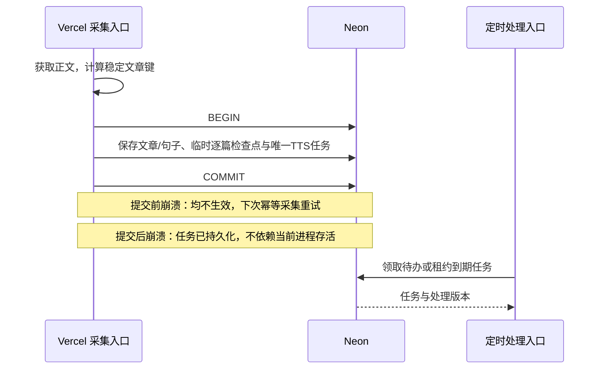

# 后台一致性、免费资源与容量清理方案

日期：2026-11-15（America/Toronto）。当前 ADR-0003/0005/0007 已接受：临时任务完成即删；Neon 数据库与对象存储，应用计算 Vercel；文章/例句音频按对象创建时间 FIFO、95%/90%，全部个人学习文本保留。下文 Vercel Blob/Queue 数字只作比较留档，实际未启用。本文无实现/实测结果。

## 推荐只使用 Neon 任务表

用户已选择 PostgreSQL 临时任务表、Vercel-managed Neon 数据库和 Neon Object Storage，不叠加 Vercel Queue。应用计算仅 Vercel；数据库入口和存储同平台并不扩大 SQL 事务到外部对象 API。

| 方案 | 一致性处理 | 代价与适用条件 |
|---|---|---|
| Neon 任务表，推荐 | 文章与任务同一事务，提交时一起可见 | 要实现领取、租约、检查点、失败重试；适合现在接受的 15 分钟处理节奏 |
| Vercel Queue + 事务 outbox | 文章与待发送事件在 Neon 同一事务；发送器把事件投递到 Queue，消费者幂等 | 触发及时，但额外维护发送状态、消息 TTL 与队列额度；适合后续确有低延迟需求 |
| 先写文章再直接发 Queue | 数据库提交后崩溃，任务消息可能永远没发出 | 单靠消费者检查文章存在，无法发现根本没有消息的文章；不选 |
| 先发 Queue 再写文章 | 消费者可能早于文章提交；文章写入失败时留下无效消息 | 临时缺记录需重试，永久失败需终止；仍未建立跨系统原子提交，不选作完整保证 |

普通 Neon SQL 事务不能将外部 Queue 的发送也变成同一个原子提交；没有发现可据以设计跨这两项产品的事务协议。outbox 是最小待发送事件记录，不是再维护一套同样的工作队列，但此时确实会增加复杂度。

### 采集提交

稳定文章键和任务唯一键防止采集重试建立两份工作；调度锁定到期计划，同事务创建频道任务并推进next_run_at；不建立永久计划发生记录。数据库提交结果未知时，以稳定键查询并重试，不能因未收到响应就无条件插入新任务。

[PostgreSQL 事务](https://www.postgresql.org/docs/current/tutorial-transactions.html)提供同库写入的原子性；不意味着 HTTP 获取正文、外部 TTS、Blob 上传也在这个事务内。

### 领取、长任务与恢复

- 每次唤醒查询所有到期频道和可执行积压，以游标/小批次持续领取；不是只处理一篇，也不无上限同时启动所有文章。
- 领取使用短事务、行锁及租约；多实例使用 `FOR UPDATE SKIP LOCKED` 避免重复领取同一行。其用途与限制见 [PostgreSQL SELECT](https://www.postgresql.org/docs/current/sql-select.html)。
- TTS 在事务外执行。每项长工作分成可恢复步骤，保存已完成的音频分块与状态，正式发布前检验分块覆盖全部正文。
- 租约续期及最终写入检查处理版本；租约到期后被其他实例领取，旧实例不得提交覆盖新结果。任务逻辑至少一次执行，业务结果通过唯一键、版本检查实现幂等；不声称外部 TTS 调用绝不会重复收费。
- 单个 Hobby 函数最长 300 秒。建议处理入口在约 240 秒进入收尾，保留保存检查点和响应的余量；这个时间是工程提议，不是已测吞吐保证。单步无法在时限内完成的 TTS 引擎不能靠队列消除该限制。
- 循环持续处理任务直到无可执行工作或接近时间预算；剩余工作保留，下次唤醒继续。失败记录错误、重试时点和次数，带退避，避免坏文章占满每一轮；具体重试参数留 Design。
- 不把未等待的 Promise 或函数返回后的后台运行当作持久保证。

### 数据库与 Blob 的一致性

任务表只包含未完成工作。成功发布时，在同一个最终数据库事务中更新文章就绪状态与资产引用，并删除本次任务及其临时进度记录；不保存完成任务行或完成任务归档。失败、待重试、处理中、等待资源仍是未完成，可留表。2026-11-16用户澄清：Source/Channel/时间计划是稳定配置；到点创建channel_collect任务，可有逐篇pending_job_items明细。正文/句子及对应TTS任务可靠保存后，删除频道任务及全部明细；TTS成功发布时再删各自任务。此前永久采集运行记录是AI误解，已撤回。只保留独立调用用量/费用记录，不复制采集任务历史。

任务删除后，幂等依据仍在固定文章、资产状态和稳定采集键中，不设文章版本。采集重试先核实既有文章是否已就绪，不能仅靠任务唯一键防重复，因为成功任务行已经被删除。最终事务响应丢失时查文章状态；任务行不存在不独自证明成功。

即使去掉外部 Queue，数据库和对象存储仍然是两个系统，需要显式恢复：

| 中断位置 | 恢复方式 |
|---|---|
| 正文写入事务未提交 | 无文章/任务，下一次采集按稳定键重试 |
| 文章与任务提交后、TTS 前 | 租约领取后继续 |
| 某分块已上传、检查点未保存 | 使用可识别的资产键及校验信息进行核对；未引用对象进入延迟清理，不能直接算作已发布 |
| 全部音频就绪、发布事务前 | 重试最终校验，事务内更新资产引用、文章可见状态并删除成功任务 |
| 发布事务成功但未收到响应 | 查询状态返回既有结果，不能重复建文或再次无条件生成 |
| 删除过程中进程终止 | 保留资产清理状态，下次继续；逻辑/S3 删除响应不等于配额释放，按供应商实际计量核对已占用字节 |

资产不可被过期实例覆盖，路径含文章ID、分块身份及任务租约fence/内容散列，不设文章内容版本。选择不可变对象，避免旧任务或缓存写回覆盖新资产；生成完全相同字节不是幂等的前提。未完整就绪文章始终不进入列表、搜索或播放队列。

## 本项目需要关注的 Vercel 配额

这是本项目资源清单，不是 Vercel 所有产品清单。以下是截至核对日的公开 Hobby 数字；同一计量范围内的 staging、preview、spike、其他项目及人工控制台操作也需预留，不能假设每个应用实例各有一份免费额度。

| 资源 | 当前免费额度/硬边界 | 本项目消耗来源 | 规划 |
|---|---|---|---|
| Active CPU | 4 小时/月 | 正文提取、分句、编码、服务端 TTS/ASR、页面/API | 记录阶段耗时；候选实测后按月推算，不以“库免费”代替 CPU 测算 |
| Provisioned memory | 360 GB·小时/月 | 函数活跃期间的配置内存，包括等待外部请求的时间 | 空队列即返回，避免定时入口每次挂满 5 分钟 |
| Function invocations | 100 万次/月 | 网页/API、采集、worker、重试 | 用户请求与后台任务一起计量 |
| CDN requests | 100 万次/月 | HTML、JS、API、音频等 CDN 请求 | 减少重复请求；不误把缓存命中当作完全不计数 |
| Fast data transfer | 100 GB/月 | CDN 到用户的页面、文件、API 响应 | 音频交付路径需一起评估 |
| Fast origin transfer | 10 GB/月 | CDN 与函数等源站通信 | 不假设音频只计一次流量 |
| Vercel Blob storage，若选用 | 1 GB·月平均占用 | 文章和例句音频；生成分块也计入 | 所有新增音频路径按 95%/90% 清理；不放模型、原始录音或数据库备份 |
| Blob data transfer | 10 GB/月 | 音频下载等 | 删文件不退还已经发生的下载量 |
| Blob simple operations | 10,000 次/月 | 元数据读取、特定未命中读取等 | 避免为每次点击反复读取元数据 |
| Blob advanced operations | 2,000 次/月 | 上传、复制、list、部分 TTL/分块操作 | 优先最终每篇一个可播放文件；断点分块、例句及核对操作另算 |
| Schedules Beta | 每期 5,000 次运行；Hobby 最密 15 分钟，抖动 15 分钟 | 唤醒采集/worker | 生产共用心跳，清理嵌入 TTS 任务；其他环境仅验证时启用 |
| Vercel Queues Beta | 100 万 API operations/月；消息默认保留 24 小时、最长 7 天 | 已决定不使用 | 仅为选型对比留档，不计入本项目已用资源 |
| Workflows、付费监控、AI Gateway | 未纳入推荐方案 | 不由本项目主动使用 | 不为已有需求多加这些计费产品；OpenAI 直接服务端调用 |
| 图片优化 | 当前不需要 | 不采文章图片 | 不引入文章来源图片优化工作 |
| 构建/单次函数边界 | Hobby 100 次部署/天；函数 2 GB、300 秒；普通 Node 包 250 MB / Python 500 MB | CI、预览和原生语音库 | 包体、运行库和权重一起计算，不只看模型压缩包 |

依据：[Hobby 配额](https://vercel.com/docs/plans/hobby)、[计算计量](https://vercel.com/docs/functions/usage-and-pricing)、[CDN](https://vercel.com/docs/manage-cdn-usage)、[Blob](https://vercel.com/docs/vercel-blob/usage-and-pricing)、[Schedules](https://vercel.com/docs/schedules/limits)、[Queues](https://vercel.com/docs/queues/pricing)、[Queue 月额度价格表](https://vercel.com/pricing)、[函数资源限制](https://vercel.com/docs/functions/limitations)。

### 额度更新与耗尽

- Queue 的 100 万次是按月提供的使用额度，不是账户终身余额，也不是用完就清空数据库或必然立即清空所有队列消息。
- Hobby 没有普通付费账期；[Hobby 文档](https://vercel.com/docs/plans/hobby)说明多数超额需要等待 30 天。不能将所有产品统一承诺为每月 1 号零点重置。Schedules 文档使用“billing period”表述，Queue 价格表按月列额度；具体账号窗口要以 Usage 数据为准。
- Queue 公开限制页没有完整说明每一种额度超限时，既有消息消费、错误码和恢复的全部细节。不能据此承诺消费会继续或恢复后消息还在；消息 TTL 与月用量独立。这是若选 Queue 需核对的剩余事项，不把未实测行为写成保证。
- [Fluid Compute 文档](https://vercel.com/docs/functions/usage-and-pricing)明确：超额可能暂停部署并出现 503；Hobby team 被暂停后，不会仅因时间经过就必然自动恢复，可能需要联系支持。此前“等额度恢复即可继续”的笼统表述不适用于所有情况。
- 删文件不返还过去的 CPU、请求、上传操作或下载量。存储按时间平均计量，删除降低之后的占用，不把本期历史占用归零。

### 参考量核算与空闲行为

- 15 分钟一个生产心跳：30 天 2,880 次，31 天 2,976 次。两套环境持续运行就可能超过每期 5,000 次，故不默认复制生产心跳到全部环境。
- 480 篇/月若每篇仅上传一份最终音频，约 480 次上传；若另存每篇 40 个句子音频，再上传整篇，约 19,680 次上传，已明显超出 2,000 次高级操作。实际 multipart、TTL 和重试还要另计。
- 480 篇/月若每篇平均消耗 30 CPU 秒，已经用完 4 CPU 小时，尚未计网站和 Speak。30,000 次 Speak/月也不能假设免费本地识别无限供应。
- 2 GB worker 若每次心跳均运行满 5 分钟，30 天约用 480 GB·小时，超过 360 GB·小时。空队列必须立即退出，不能为等待下一任务而常驻。

### 检查与记录

日常记录音频实际字节、创建时间、预留与未完成任务阶段；不增加费用看板。所有新增音频路径维护清单，低频核对对象。实际选 Neon：对象 5 GB、公共出网 5 GB/月与数据库等共享；Vercel Blob 列表仅供对比，见 object-storage-options.md。

[Blob SDK 的 list](https://vercel.com/docs/vercel-blob/using-blob-sdk)返回对象大小，默认每页 1,000 条；核对本身消耗高级操作。实际总字节与账单 GB·月不同，应用记录不能代替平台最终计量。

对 CPU、流量和操作数采用应用内估算加平台 Usage 核对。[官方用量 API](https://vercel.com/changelog/access-billing-usage-cost-data-api)支持日粒度记录；[CLI](https://vercel.com/docs/cli/usage)支持 JSON 输出。实际账号权限、Hobby 各指标是否完整暴露以及数据延迟尚需验证，不能宣称已有实时全资源额度 API。凭据服务端保存，不增加密钥明文或客户端管理令牌。

## 按对象创建时间自动清理音频

用户已指定对象创建时间 FIFO、95%/90%，文章和例句音频都参与，例句命中播放、缺失生成。已选 Neon Free 当前 5 GB，对应约 4.75 GB/4.5 GB；实际项目范围、分支保留与删除释放须核对，不能把逻辑删除直接算成释放全部配额。

### 触发及选择

1. 文章 TTS 任务和例句音频未命中生成路径均检查容量，达到 95% 时清至低于 90%；上传前核实“已占用 + 其他预留 + 实际新增”，不另设定时清理器。即时例句请求直接生成，不等待 15 分钟扫描。
2. 使用存储范围内的锁或原子预留，避免多个 worker 各自判断有空间后一起超额。生成后用实际大小修正，超过预留则先扩展预留/清理再上传。
3. 按对象首次成功创建时间及稳定对象 ID 排序，先旧后新，不按文章采集时间，也不因缓存命中更新顺序。无引用对象仅删除资产；活跃任务仍在写的对象不能误判为孤儿。
4. 若淘汰文章当前必需音频，在同一数据库事务中删除文章、正文、句子、时间轴、资产引用及访问记录，同时将 media 资产元数据标为 retiring，只留对象键/版本/大小等物理清理字段。文章不能仅标记不可见后继续保留；旧 worker、迟到访问及新播放授权不得恢复它。例句音频在事务内只失效音频引用、标记资产待删，保留例句表行和所有个人学习数据。
5. 事务提交前不删除物理对象；提交后用持久化资产清理状态幂等删除。DB 回滚时文章/引用均保留且对象未动；提交后进程退出则从 retiring 元数据继续删，不需要已删文章才能重试。成功后移除待删元数据。例句文本仍留表，下一次点击朗读即时生成缓存；SQL 与 S3 没有共同事务，不承诺物理删除同一瞬间完成。
6. 缺对象可幂等处理，其他错误不当成功；对象在当前访问视图消失与项目配额实际释放分别核对。特别是 Neon 分支软删除，不假设 DeleteObject 成功即按同样字节释放项目总量。缓存传播、历史占用及其他分支仍需验证。
7. 重复选择最早音频对象直到低于低水位；被淘汰文章保留最小来源去重键，避免反复抓回。例句音频下次需要时允许重新生成，成为新创建对象；不重置原例句的学习进度。

用户最终明确：文章当前音频被删除时，对应文章也必须同时删除，并清访问记录；例句音频删除则保留例句表行，下次点击朗读重新生成。全部个人查词缓存文本、词卡、例句与复习进度保留，个人快照不从文章/音频 FK 级联删除。此边界已直接确认，不再仅为前后访谈的推导。

缓存上下文句子快照由缓存自身持有；保留个人解释所需片段，不恢复完整文章。恢复后核对音频引用与容量，缺完整音频的文章不能直接可见，不自动重新生成全部淘汰文章。主动淘汰不属于承诺可恢复的误删。数据库恢复坚持 Neon Free 的有限历史/单手动快照，用户接受弱保障，见 ADR-0013；不在音频缓存桶备份数据库。

列表/搜索不再返回淘汰文章，阅读历史对应行已删除；旧链接和播放队列遇到淘汰项时提示过期或跳过。具体文案与活跃播放保护时间留 Design。

### 清理无法解决的边界

- Blob 现在同时缓存文章与例句音频，二者都可按 FIFO 淘汰。个人文本缓存增长影响数据库容量，不能借音频清理删除它们。
- 没有足够可清理旧文章时，保留后台任务的 waiting-for-capacity 状态并报告原因，不随机删其他资源、不发布缺音频文章、不自动升级。
- 当前方案不添加因总费用达到 30 美元而限制用户使用的逻辑。平台的流量/CPU/操作硬额度仍可能中断服务，不能用文章 GC 宣称全部免费容量问题已解决。
- 权重、原始录音与数据库备份不进入音频缓存；预览/测试若产生缓存音频，也须在实际计量范围内计算。Neon 凭据/分支隔离与释放计量需特别验证。
- 用户“通常一个音频小于 5%”是参考假设；超长音频、多任务并发和分块可能超过余量。上传采用串行或原子预留，异常大文件不能仅因当前低于 95% 就强行写入；保留未完成任务并报告处理要求，不擅自改回其他清理阈值。

## 验证与后续选择

后台机制与清理规则已接受，后续 Design 细化表结构、索引、租约和任务版本。实现时验证并发领取、提交前后中断、成功任务删除后的重复采集、TTS/上传中断、并发预留、清理恢复和访问记录不被迟到请求复活。当前无运行或故障注入结果。

TTS 与 Speak 分别做候选 spike，Speak 必须验证实际 Hobby 硬件/资源及月免费容量，见 speech-candidates.md 和 ../product/speak-spike-plan.md。D-014 与完整流程仍在 staging，不增加独立全站性能 spike。
