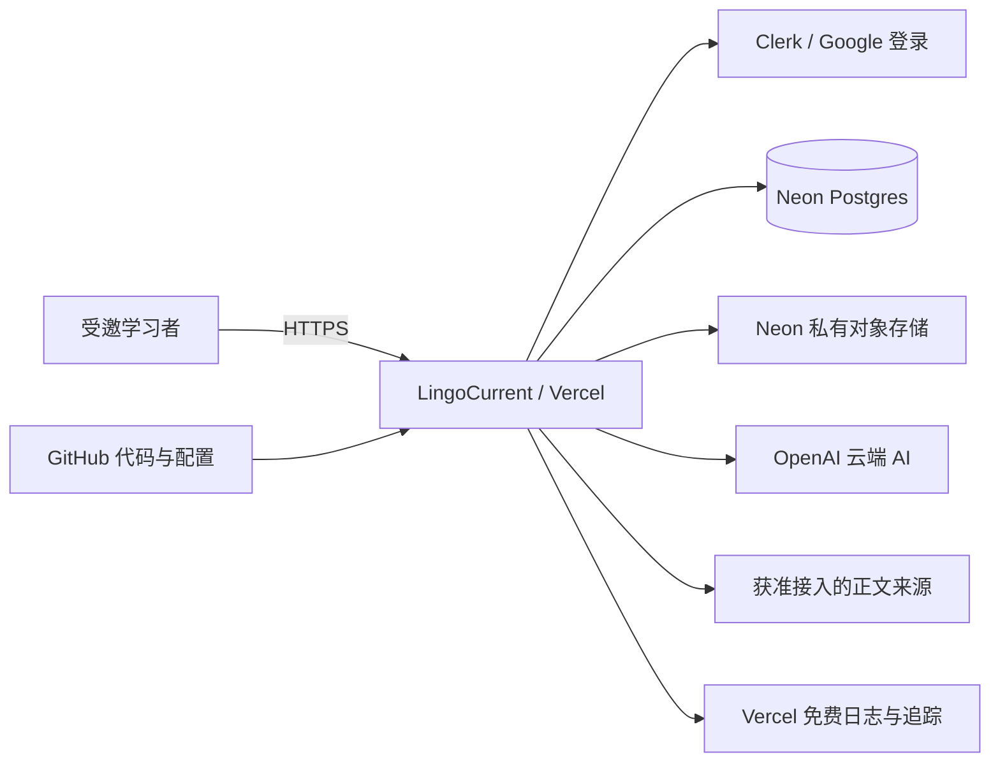
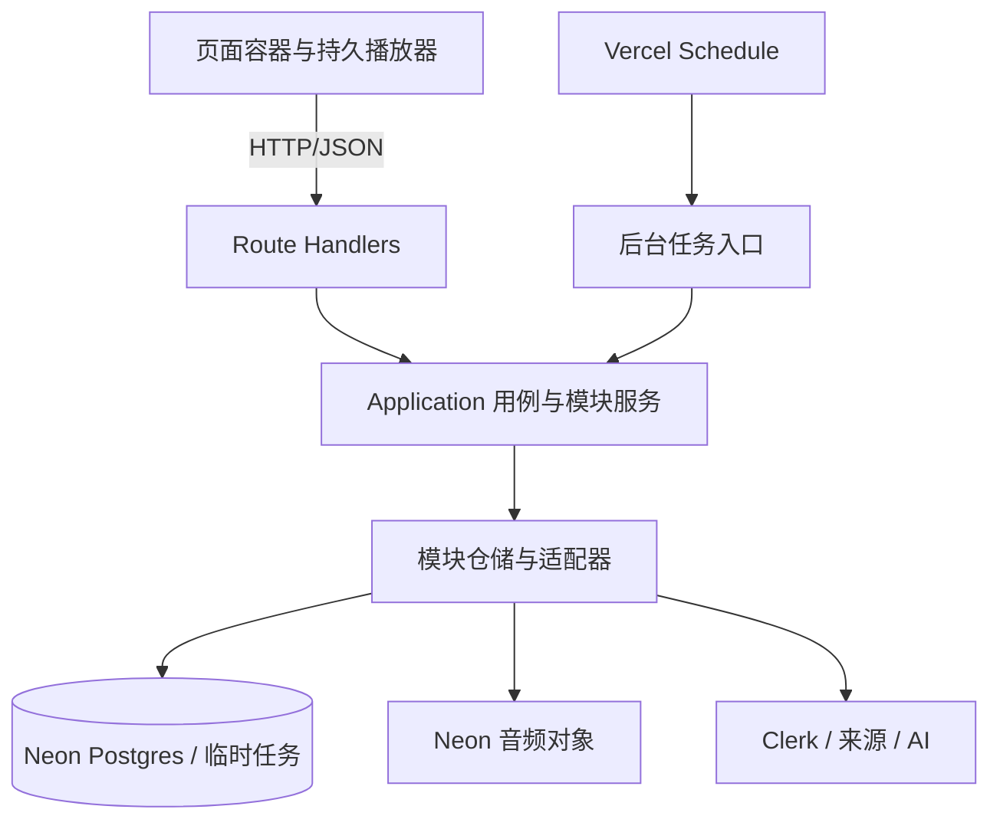
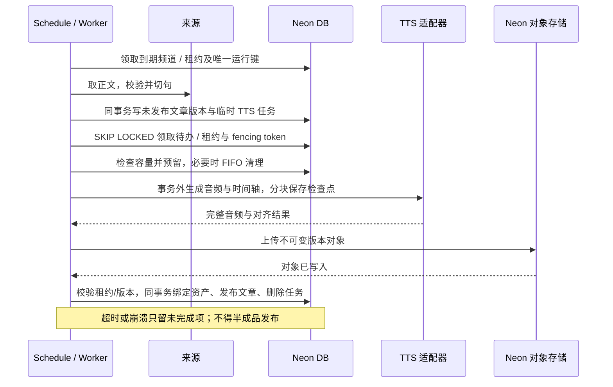
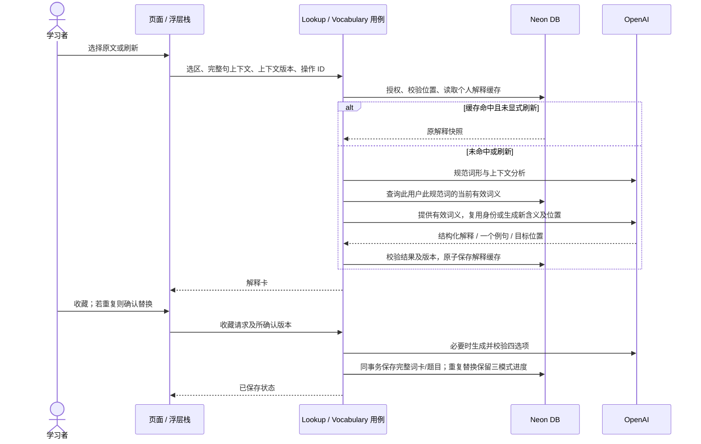
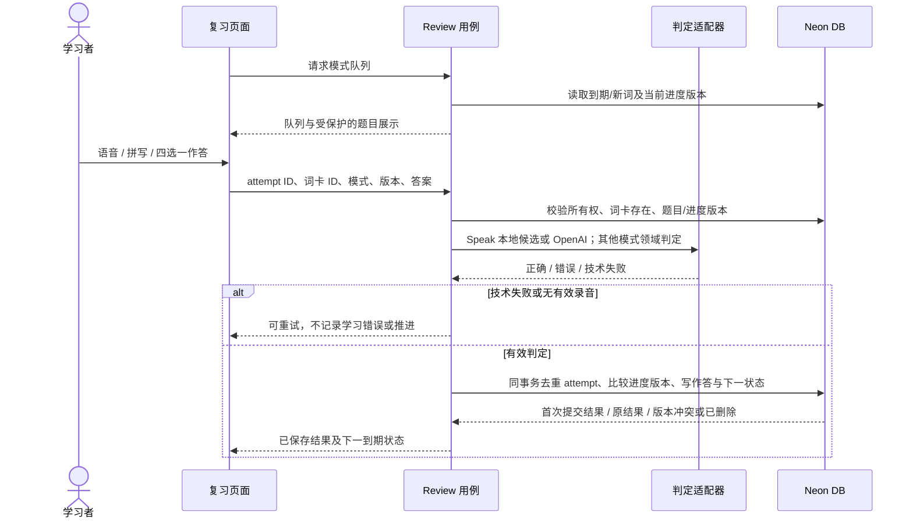
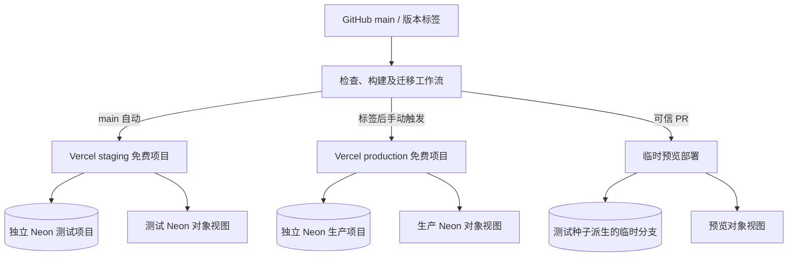

# LingoCurrent 架构总览

日期：2026-11-15（America/Toronto）。状态：已确认，architecture 定稿；用户最终审阅明确文章/音频共同删除、例句文本保留并按需重建音频，其余方案通过。技术选择见 [ADR 目录](../README.md)；语音引擎 ADR-0016 保持提议，等待两个 spike。尚无应用实现、云资源配置或实测结果。与历史访谈冲突时，以最新已接受 ADR 为准。

## 架构指标

| 指标 | 目标或边界 | 依据 |
|---|---|---|
| 人员 | 一人维护，无指定技术偏好；每周时间未提供，不承诺交付日期 | 架构访谈 |
| 用户/并发 | 首年 1,000 账号，100 人同时使用；不是 100 路同时语音识别 | REQ-031 |
| 活跃测算 | 100 日活，每人每天 10 次未命中/刷新查词、10 次 Speak，各约 30,000 次/月 | 用户选择，仅用于测算，无用户额度 |
| 内容测算 | 16 篇/天、800 英文词/篇，约 480 篇/月、5,840 篇/年；频道仍独立配置 | REQ-003；用户容量参考 |
| 响应 | 正常网络列表/已生成正文 P95 ≤ 3 秒，AI 查词/判音 P95 ≤ 10 秒 | REQ-031、D-014；尚未测量 |
| 可用性 | 月 99.5% 设计目标；免费托管没有本项目 SLA 保证 | 用户初始选择 |
| 恢复 | 坚持 Neon Free，接受有限历史恢复及单手动快照的较弱保障；不承诺原先 24 小时 RPO/RTO | 用户最新选择；ADR-0013 |
| 一致性 | 词卡/选项原子更新，复习不重复推进，旧请求不能复活删除项；文章正文、完整音频、时间轴齐备才发布 | REQ-005、REQ-017–REQ-021、REQ-028、REQ-030 |
| 安全 | Clerk 邀请制 Google 登录；个人数据隔离；原始作答录音不长期保存；来源接入先核对使用条件 | REQ-002、REQ-023、REQ-029；Q-001 |
| 成本 | Vercel 与 Neon 坚持免费，不自动升级；总月费 30 美元是优化期望，无按该金额限制用户或停用功能的规则 | REQ-029、REQ-031；最新访谈 |

容量公式、平台依据见 [inputs](inputs.md)、[免费可行性](free-tier-feasibility.md)、[任务与资源计划](background-and-resource-plan.md)。100 并发、响应目标和总体费用均需 staging 证据；免费额度不等于已能承载目标规模。

## 架构风格与已选技术

采用运行在 Vercel 的模块化单体：一个 Next.js/TypeScript 代码库、一套模块契约，HTTP 与后台任务使用相同业务服务。托管函数按请求启动多个实例，所有业务状态存 Neon。单体避免维护多个业务服务，但网络、并发、对象存储和数据库之间仍有分布式故障。

| 层面 | 已选方案 | 取舍与决策 |
|---|---|---|
| Web/API | Next.js App Router + TypeScript，Route Handlers，HTTP/JSON REST | 页面/API 同项目；需适配现有 React/Node 规范，ADR-0001/0002/0011 |
| 数据 | Vercel-managed Neon Postgres；Drizzle；Zod | 保留 SQL 事务控制，运行时校验输入及 AI 返回；ADR-0006/0007 |
| 后台任务 | Neon 临时任务表；生产每 15 分钟唤醒 | 与文章同事务，不引入 Vercel Queue；完成即删，ADR-0003 |
| 音频 | Neon Object Storage；文章/例句音频缓存 | S3 兼容独立对象存储，按创建时间 FIFO，95% 触发、清至低于 90%；ADR-0005/0007 |
| 前端状态/样式 | TanStack Query、Zustand、Tailwind + 设计令牌 | 服务器数据、播放/浮层界面状态分开；ADR-0009 |
| 组件与视觉 | 容器/展示组件、原生语义组件、自有样式、AI 设计稿先确认、Storybook | 定制自由，项目承担焦点/键盘验证；ADR-0010 |
| 工程 | pnpm；版本化 Drizzle SQL 迁移；Vitest/RTL；Playwright 功能/截图 | 固定工具版本，迁移可审查；ADR-0008/0010 |
| 追踪 | @vercel/otel + 内置免费 Tracing；JSON 日志；数据库用量记录 | 免费追踪有采样、短留存和团队配额；ADR-0014 |

语音引擎、音色、编码参数和 Speak 的 K 值仍是候选，须分别执行 TTS/Speak spike；不能从论文/模型卡推定本项目质量或免费可运行。见 [语音候选](speech-candidates.md) 和 ADR-0016。

## 系统上下文

正式来源清单仍待用户确认，NASA/NOAA/NIH/NSF 仅为候选，Yahoo 仅为需求举例。不调用 Neon Functions、Auth 或 AI Gateway；Clerk 负责身份，Vercel 承担应用计算。

## 分层与代码目录

项目直接位于当前 `english` 根目录。下列是目标目录，尚未生成；不再套项目名称目录，不因模块化而创建多个独立应用。

| 层/目录 | 职责 | 允许依赖 |
|---|---|---|
| `src/app/` | Next 路由、布局、HTTP 输入输出及身份适配 | 页面容器、服务端 application、共享契约；不写 SQL/领域规则 |
| `src/features/<feature>/pages/` | 客户端取数、交互编排与状态连接 | 本 feature 的 data-access/components，客户端共享库 |
| `src/features/<feature>/components/` | 展示组件，只接收参数及回调 | 展示组件、共享 UI/纯工具；不取数或导入全局业务 store |
| `src/features/<feature>/data-access/` | TanStack Query 请求、缓存键、失效策略 | 类型契约与 HTTP 客户端；不导入 server |
| `src/client/` | 持续播放器、队列、选区及浮层宿主、Zustand providers | 客户端契约/UI；每个客户端独立实例 |
| `src/server/application/` | 用例、跨模块编排、事务边界 | 模块公开服务/端口、事务抽象；不绕过模块主人直接写表 |
| `src/server/modules/<module>/` | services / repositories / domain，模块拥有自身数据 | service → repository 端口/domain；domain 不依赖框架/数据库 |
| `src/server/infrastructure/` | Drizzle 仓储实现、Clerk、来源、模型、S3、追踪适配器及 bootstrap | 领域端口、SDK；bootstrap 负责注入，业务不反向依赖 SDK |
| `src/shared/` | DTO/Zod 契约、设计令牌、语义 UI、纯工具 | 不依赖业务模块、服务端秘密或路由 |

服务端用 `server-only` 阻止进入浏览器包。ESLint/Prettier 与 dependency-cruiser 在 scaffold 落地；将规范库 React/Node 分层改成上述 Next 路由与应用边界，禁止 Next 页面绕过 service 直接访问仓储。唯一装配入口的例外要有明确路径白名单。当前无应用代码，无旧系统迁移。

## 组件、接口与数据主人

各业务模块位于 `src/server/modules/<下表模块>/`，均为 TypeScript，外部通过 application 用例调用；对外 HTTP 路径以 `/api/v1` 为前缀。具体 DTO/表字段在详细设计中确定。

| 模块 | 责任及独占数据 | 接口方向 | 依赖 |
|---|---|---|---|
| identity | Clerk 身份绑定、受邀/有效成员映射 | 请求身份及成员授权 | Clerk、DB |
| content | 来源、频道、时区计划、采集运行、文章版本、句子与时间轴、FTS 索引、临时任务 | articles/search、采集/任务用例 | 来源适配器、DB、media 端口 |
| reading | 用户文章访问记录 | visits、历史、启动时完整匹配集快照 | DB、content 公开查询 |
| lookup | 个人上下文快照、解释文本缓存、词义绑定及刷新版本 | lookups、显式 refresh | DB、AI、vocabulary 的有效词义查询端口 |
| vocabulary | 有效词义身份、收藏词卡快照、四选项、例句版本 | vocabulary、确认替换、固定词义换例句、删除 | DB、AI、review/media 公开端口 |
| review | 每词每模式进度、到期时间、作答记录、短练状态 | sessions/attempts，Speak/Spell/Translate 判定 | DB、词卡只读端口、语音适配器 |
| media | 资产元数据、缓存键、对象创建时间、容量预留与删除状态 | 授权播放 URL、文章 TTS、例句缓存 | DB、S3、TTS 适配器 |
| usage | 模型每次尝试的用量、费用口径、未知结果、关联操作 | 内部记账接口，无费用看板 | DB、AI 适配器回执 |

跨模块操作由 application 组织，仓储仅写自己模块的数据；可在同一 Postgres 事务中调用多个模块端口。音频生成依赖 content 持有的唯一临时任务表机制，不另外造一张例句队列或任务历史。review 拥有进度，vocabulary 删除用例通过 review 端口原子删除关联记录。

客户端 query key 含用户与资源版本，退出/切换账号清除个人缓存；Zustand 不作为服务端进度来源，也不在服务端全局共享用户状态。AI 刷新与收藏必须显式触发，自动页面重新取数不触发 AI 生成。

## 关键场景

### 采集、文章朗读和发布（REQ-003–REQ-005、REQ-030）

生产每 15 分钟唤醒，扫描到期频道和现存任务，时间预算内持续处理多项，空队列立即退出。不能保证一次清空任意积压，也不保证来源发布后立即发现。接近函数截止前保存进度并释放/等待租约过期，下轮继续；不依赖请求结束后的不受保障后台线程。

文章版本、来源唯一键和发布状态保证任务删除后的幂等；“任务行不存在”本身不表示成功。任务成功与发布同事务提交，不保留 done 行。采集运行记录和模型调用用量是独立业务记录。上传后进程退出产生的孤儿对象由对账回收；旧租约不能覆盖新版本。细节见 [ADR-0003](../adr/0003-background-consistency.md)、[ADR-0015](../adr/0015-consistency-and-boundaries.md)。

### 查词、词义复用和收藏（REQ-012–REQ-018、REQ-020–REQ-021）

规范词形阶段与最终释义阶段可以由适配器编排，必须在最终词义选择前提供当前有效收藏词义；不向模型提供已删词卡，也不靠中文译名字符串去重。并发期间词义集合改变则重检/重试，避免创建两个同义身份。选区保留原词形和相关完整句，跨视觉行/相邻句仍是连续文本范围。

持久解释缓存和收藏快照独立。解释刷新固定含义、只更新缓存；词卡换例句固定词义，仅在原题仍有效时复用选项。外部生成全部在数据库事务外，最终用版本比较更新；失败保留旧值。删除词卡后旧异步回调不能 upsert 恢复，重新收藏建立全新 ID 和零进度。

### 复习判定、重复请求与删除竞争（REQ-022–REQ-028）

DB UTC 时间决定到期，三个模式独立。正式成功增加已完成轮次；错后 10 分钟重练，短练成功保持阶段并重新等待原间隔，反复错继续 10 分钟。1/2/4/7/15/30 天来自统一常量表，索引与终点在详细设计明定，不另硬编码“七轮/59 天”。

重复 attempt 返回已提交结果，不重复推进；并发不同 attempt 只有匹配当前版本的一次提交成功。删除事务移除词卡、题目及全部复习记录，旧请求返回不存在/冲突；不用保留隐藏复习记录维持幂等。当前会话到期短练可重入，新收藏词下次启动加入。

## 播放、选区与音频生命周期

客户端根外壳持有单一音频所有者，跨路由保留。启动列表播放时获取当时完整匹配集的稳定 ID 队列，跨分页播放；新文章下次启动才加入，已淘汰文章跳过。句子左侧按钮点播、再次停止清除；全文从所选句起，否则从头。时间轴与正文版本绑定，支持进度、速度、自动翻篇/滚动/高亮。

打开解释不暂停文章；播放例句才暂存文章位置，结束后由用户手动恢复。嵌套浮层以栈管理，空白/Escape 退一层。目标位置保存字符范围并校验原文切片；具体索引约定在契约中统一，避免 Unicode 偏移错误。未作答隐藏目标构成不可跨选边界；服务端限制可查上下文与整句音频授权，防止仅靠 CSS 隐藏泄题。后台/锁屏播放通过浏览器媒体能力实现，真实手机 staging 验证，不承诺所有浏览器。

所有文章与例句音频统一进入 Neon 对象缓存。例句命中直接播放，未命中即时调用生成路径，复用相同临时任务/租约单飞机制，不等 15 分钟心跳。缓存键含文本版本、音色/模型、编码及必要的用户访问范围；重复点击不无限并发生成。

每次生成都检查容量及并发预留。已占用达 95% 时按**对象创建时间**从早到晚清到低于 90%；播放不更新创建时间，不改成 LRU。上传前再核对实际大小与预留，即使未达触发点也不能超出剩余容量。5 GB 配额下参考 4.75/4.5 GB，实际按供应商口径计算。

用户最终明确的删除不变量：淘汰文章当前必需音频时，必须同时删除对应文章、正文/句子/时间轴、专属资产引用及访问记录，不能留下文章等待重建朗读。例句音频淘汰只清音频和缓存引用，例句仍留在表中，下一次用户点击朗读时重新生成并缓存音频。全部查词缓存文本、词卡/例句文本及复习进度保持；lookup 上下文快照独立，不级联删除。未引用的旧版本/孤儿对象只清资产，不删除仍有完整当前音频的文章。最小来源去重标识防止反复采回刚淘汰旧文，不保留文章正文。

创建和删除均保证应用业务的一致可见性；SQL 与 S3 不存在共同的原子事务。删除文章音频先在一个 DB 事务内删除文章及正文/句子/时间轴、资产引用和访问记录，同时把待物理删除的 media 资产元数据标为 retiring，仅保留对象键/版本/大小等清理必需字段，不保留文章。例句删除则在同一事务失效音频引用并标记资产待删，保留例句表行。事务提交前不删除物理对象；提交后幂等删除，失败依持久资产状态重试，成功后移除待删元数据。读取/授权不再返回已删文章，旧 worker 和迟到访问写入不能恢复它。已发出的短期签名 URL 有效窗口不等于可重新查询文章。清理状态不是第二套队列或任务历史；尚未物理删除的孤儿对象不对用户重新暴露。Neon 分支软删除不保证立即释放实际额度，按供应商计量核对；空间仍不足则保留生成待办并报告，不无限删新内容或个人学习数据。见 [ADR-0015](../adr/0015-consistency-and-boundaries.md) 与 [对象存储比较](object-storage-options.md)。

## 部署、实例与交付

| 组件 | 环境与实例 | 状态/扩展 | 健康检查 |
|---|---|---|---|
| Next HTTP | staging/prod 各一个 Vercel 项目；PR 使用预览部署；实例由平台按需分配 | 无状态，可 0 到平台允许的多实例；Vercel 路由负载均衡，不承诺常驻双实例 | 轻量存活接口；受保护就绪检查有短 DB 超时，不每次调用 AI |
| Schedule/worker | 生产一条持续 15 分钟唤醒；测试只在窗口开启 | 无状态，多次触发靠租约/唯一计划键协调；函数有截止时间 | 心跳/积压与租约异常记录；不能只凭 HTTP 200 判定业务完成 |
| Neon DB/对象存储 | 生产与测试独立项目，预览从测试种子派生 | 托管状态，无自建主备或付费副本；Free 有计算/分支/容量限制 | 连接、引用对象抽查、额度核对 |
| 本地 | compose 两个应用副本、Postgres、S3 兼容模拟器、AI stub | 检查多实例竞争；Clerk 使用开发配置，真实云适配器另测 | 应用/依赖健康检查 |

建议 Vercel 与 Neon 同选可用的 US East 区域以减少跨区延迟；创建资源时核对支持范围，不把建议区域写成已部署。模型如需独立 Python/native 函数，也随同一版本部署在 Vercel，不增加常驻服务器；运行时与打包方式由 spike 证据确定。

pnpm、Node 和框架版本在 scaffold 核对官方支持后固定并提交锁文件。`infra/docker-compose.yml` 是待 scaffold 生成的目标，模拟器不能替代 Neon 分支、软删除及计费验证。CI 运行格式/lint/类型/架构检查、相关测试、Storybook 构建、Playwright 关键流程和统一环境截图；截图基线变化需审阅。数据库并发/事务使用真实测试 Postgres，不以 mock 证明。

main 自动到 staging，版本标签后手动 `workflow_dispatch` 到生产；关闭绕过此流程的 Git 自动生产部署。迁移以 Drizzle schema 生成、人工检查后提交 SQL，由环境发布流程串行执行；运行时不 schema push。先扩展、迁移/回填，再收缩，保留旧应用兼容期。回滚恢复已知应用与配置版本，不能自动恢复被删除对象或逆转数据变更。

预览不从生产复制个人数据；使用测试种子与环境独立身份/DB/S3 凭据，PR 关闭删除临时分支/对象视图。Neon Free 分支数量有限，超量时排队/清理已关闭分支，不自动购买。只有 OpenAI key 按用户要求所有环境共用，其他秘密隔离。GitHub Secrets/Variables 是静态配置源；Vercel-managed 绑定和动态预览连接串需在受信工作流核对，不把短期 URL 打印或提交。

## 数据、一致性与恢复

| 数据 | 唯一主人/存储 | 一致性与删除 | 恢复边界 |
|---|---|---|---|
| 身份 | Clerk，identity 仅映射 | 每次服务端核对有效成员；客户端 userId 不作为授权依据 | Clerk 自身能力，不宣称 Neon 快照备份 Clerk |
| 频道/运行/文章/任务 | content / Postgres | 计划时区持久化；重复/漏调可补偿；文章任务同事务；成功任务即删 | Neon Free 有限恢复；正文/音频不齐不发布 |
| 访问记录 | reading / Postgres | 打开即已访问；文章淘汰删除关联访问行 | 不连带删除其他学习数据 |
| 解释文本缓存 | lookup / Postgres | 按用户/上下文版本/选区；显式刷新；与收藏独立 | 文章或例句音频淘汰不删除 |
| 词卡/题目/有效词义 | vocabulary / Postgres | 原子保存/版本比较；重名同义需确认替换 | 删卡移除关联题目和 review 全部记录，缓存保留 |
| 进度/作答/短练状态 | review / Postgres | attempt 去重 + 当前进度版本，DB 时间 | 已提交才显示成功；删卡后旧请求不能恢复 |
| 音频/容量元数据 | media / Postgres + Neon S3 | 私有对象、不可变版本、预留/FIFO/删除对账 | 可清缓存不是备份；DB 恢复不会自动恢复对象 |
| 用量/费用相关记录 | usage / Postgres | 每逻辑操作/外部尝试关联；未知用量标未知，不当作零 | 不依赖 3 天追踪留存；无费用看板 |

Neon Free 当前为至多 6 小时且受 1 GB 变更量约束的历史窗口、1 个手动快照，不是持续每日多版本备份。用户接受较弱恢复保障，未约定可保证的 RPO/RTO；敏感迁移前使用可用手动快照，演练并记录实际恢复时间/丢失范围。Postgres restore 不自动复原 Object Storage，恢复后核对引用、停发缺资产文章；按可用正文有选择地重建，不能重建已授权淘汰的所有旧缓存。音频缓存桶不放数据库备份。详见 [ADR-0013](../adr/0013-free-recovery.md)。

## 横切关注点

| 方面 | 设计 |
|---|---|
| 授权 | 服务端验证 Clerk session、邀请/有效成员；所有个人查询/更新带 owner 条件，资产先授权后签短期 URL；计划入口验证平台凭据，非公开批处理接口 |
| 输入/内容 | Zod 在边界验证输入与 AI 返回；核对例句目标片段、选项唯一正确性和词义 ID；来源 HTTPS 白名单、跳转/IP/体积/超时约束，正文不执行 HTML/脚本，AI 输出无任意工具权限 |
| 秘密 | 仅可信工作流注入服务端；密钥不得进 NEXT_PUBLIC、日志、Storybook 或 PR 产物；外部 PR 不获得共享 OpenAI/生产秘密 |
| API | `/api/v1`、稳定错误码/关联 ID/资源版本；写操作携逻辑操作 ID；技术失败与答错分开；客户端收到冲突重新读取，不盲目覆盖 |
| 超时/背压 | 外部请求设置短于函数预算的超时；只对可安全重试的阶段退避；任务带 payload 版本、租约和检查点；控制模型/生成并发，不形成每用户月度额度 |
| 可观测性 | OTel spans 关联 HTTP/任务/DB/外部调用，生产低比例采样、测试短窗口；JSON 错误日志、积压/耗时/失败类别及 DB 用量记录；追踪失败不改变学习结果 |
| 开关/运维 | GitHub 配置控制部署级功能；受保护 DB 运维状态可暂停某频道/生成并发并保留待办，不需重发代码；仅诊断/故障恢复使用，不把 30 美元期望变成自动停用规则 |
| 告警 | 使用免费平台现有失败/额度通知与维护者查看积压/usage；不承诺付费告警能力或新增通知服务；免费短日志窗口外的故障靠持久状态诊断 |

Tracing 的 Hobby 免费额度为团队每月 1,000,000 span units、保留 3 天；至多 2 KiB 的 indexed span 为 1 unit，更大累加，不是请求次数。耗尽暂停团队追踪，之后需要有权限者手动 Resume Tracing。使用 `@vercel/otel` 和内置接收/查看，不启用付费增强或外部 exporter。来源见 [配置与免费配额](https://vercel.com/docs/tracing/configure-tracing)、[接入](https://vercel.com/docs/tracing/instrumentation)；具体采样值实施时按流量调节，不把所有请求/个人上下文全量写入 spans。

## 免费额度与容量约束

以下是 2026-11-15 官方公开条款核对，创建资源时复核；各指标口径不同，删除文件不返还已发生计算、出网或请求用量。

| 资源 | 当前免费边界与影响 |
|---|---|
| Vercel Hobby | 4 active CPU 小时/月、360 GB 小时内存、100 万函数调用、100 万 CDN 请求、100 GB 用户传输、10 GB origin 传输；团队项目共用相应额度，不承诺超额后继续服务 |
| 函数 | Hobby 2 GB / 1 vCPU，最长 300 秒；普通 Node 包 250 MB、Python 500 MB（未压缩）；大型函数 Beta 要核对项目资格，不凭本机测试推定可用 |
| Schedule | 每 15 分钟可运行但有最多 15 分钟抖动；每团队账期 5,000 次，单生产心跳每 30 天 2,880 次，两环境持续跑会超限 |
| Neon Free DB | 每项目 1 GB 数据、100 CU 小时/月、最多 2 CU；分支及同项目活动共用，不能把 Neon DB 的 8 GB 内存当 Vercel 推理内存 |
| Neon Object Storage | 每项目 5 GB 音频；5 GB/月公共出网与 Postgres 等共用，不能把对象容量当每月可播放流量；分支保留/软删除释放要验证 |
| 免费追踪 | 团队 100 万 span units/月、3 天留存；耗尽后暂停追踪，应用业务与此分离 |

原始条款及选型比较见 [Vercel Hobby](https://vercel.com/docs/plans/hobby)、[函数限制](https://vercel.com/docs/functions/limitations)、[Schedules](https://vercel.com/docs/schedules/limits)、[Neon plans](https://neon.com/docs/introduction/plans)。Vercel Blob/Queue 均未采用，其免费额度只在比较文档留档，不计作已使用资源。

按 800 词、150 词/分钟估算，320 秒音频在 64 kbit/s 约 2.56 MB、32 kbit/s 约 1.28 MB；5 GB 理论约容纳 1,953/3,906 篇，尚未扣例句、分块、分支及预留。自然度优先于高码率，编码/音色需试听。30,000 次 Speak 若独占 4 CPU 小时，平均每次也只有 0.48 CPU 秒，实际还须扣除网站/TTS等；不能据单次能跑便宣称全月免费。数据库个人文本/复习/用量记录持续增长且不得因音频清理而删除，容量不足须另行决定，不能擅自改变保留规则。

## 故障场景

| 故障 | 用户所见 | 处理与恢复 |
|---|---|---|
| Clerk/登录故障 | 无法登录或重新授权；已加载页面不能借缓存越权保存 | 不绕过鉴权，依赖恢复后重试 |
| DB 故障/额度暂停 | 保存未成功、可重试；不显示已推进 | 不在内存排队冒充成功；恢复连接，按操作 ID 核对已提交结果 |
| 来源慢/内容不合法 | 旧文章仍可用，当次少发/不发 | 有限重试、运行记录、频道补跑；不发布不完整内容 |
| TTS/worker 超时崩溃 | 新文未显示，例句提示重试；学习文本不受损 | 任务保留/检查点/租约重领，版本对象与提交 fencing，成功即删任务 |
| 音频对象丢失/存储超限 | 例句未命中可重建；文章缺完整资产不可继续作为就绪文章 | 引用对账、缓存失效；清理按实际释放计量，超限保留任务，不无限删除 |
| AI 失败/返回无效 | 解释/题目旧值保留，Speak 技术失败可重试 | Zod + 语义校验，不算答错；限定重试并记每次实际尝试用量 |
| 多设备/删除竞争 | 旧提交提示内容已变化或已删除 | DB 版本比较/唯一 attempt；不复活、不双计进度 |
| 调度重复/漏调/迟到 | 采集延后，无准点保证 | 频道计划持久化，唯一运行键、过期租约和补偿扫描 |
| 免费 CPU/流量等硬配额用完 | 平台可能暂停应用/生成 | 记录并明确提示维护者，无自动升级；按提供商恢复流程处理 |
| 追踪额度耗尽 | 用户业务继续，诊断链路不完整 | 保留结构化日志/DB 业务状态；核对周期并手动恢复追踪 |
| 发布失败/数据恢复 | 保留旧版本或显示维护状态 | 应用/配置可回滚；SQL 兼容期，恢复后检查对象、任务版本和成员映射 |

## 视觉验收、验证门槛与演进

AI 先给设计令牌和阅读、嵌套解释浮层、词卡、三模式复习等关键状态稿，由用户确认后实现。Storybook 展示正常/加载/空/错误/隐藏目标/键盘焦点状态；Playwright 验证完整路径并作截图回归。真实手机麦克风、跨行选词、音频拖动与锁屏播放留 staging。

下一步优先按 [TTS 计划](../product/tts-spike-plan.md) 和 [Speak 计划](../product/speak-spike-plan.md) 分别做小范围探针，得到可播放样音、识别负样本结果及真实 Hobby 资源证据再决定引擎。D-014 的完整性能验证不另做 spike。正常存储集成需验证私有 Range、分支软删除/实际容量释放和恢复引用一致性；这不是第三个性能探针。

[架构检查及需求覆盖](review.md) 列出仍待证据的门槛。后续 scaffold 搭骨架，再由 roadmap 排首版全部需求；来源、声音选择及上线验证不能因文档完成而视为完成。保留模型/S3/来源适配端口、版本化任务与 API，可在未来容量证据要求时调整；当前不增加微服务、Redis、外部搜索或第二套队列。任何付费升级、扩大数据删除范围或替换保留规则都需重新决定。
