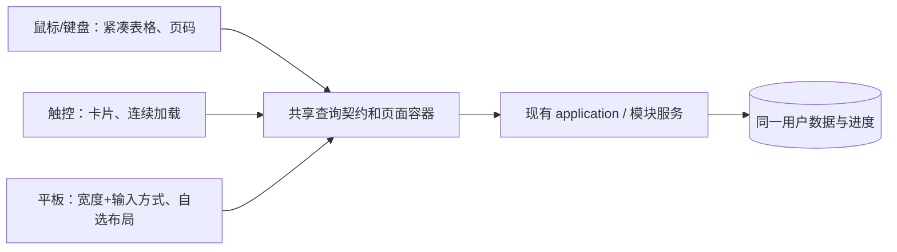

# 鼠标与触控界面修订

2026-11-16最终确认：用户明确“ok, finalize design”。Design已确认并定稿，最新复习只保留review_progress；删除review_sessions/review_session_items/review_prompts/review_attempts，不设phase或短练标记。答错round减1最低0并延10分钟，答对加1查间隔；逐题实时查询，通用mutation_receipts仅作有期限的请求去重。下方历史记录中的旧表、共享例句或待审状态均不优先于当前data-model/API及Design确认记录。实现、RSS/语音Spike、部署和真机验证尚未执行。

- 日期：2026-11-16（America/Toronto）
- 状态：2026-11-16用户已确认，Design定稿；尚未实现
- 变更级别：L2 / D2（修改未实现的导航、查询契约和展示结构；不更换技术架构）
- 相关需求：REQ-001、003、006–007、010–012、015、019、022–025、033、035–038
- 相关决策：ADR-0005、0009、0010、0011、0015、0017

第四轮补充以[紧凑图标与触控导航](../changes/2026-11-16-compact-touch-navigation.md)及[experience](experience.md)为准：移除Review快捷菜单，头像菜单退出；图标按宽度隐藏文字，模式状态各自成框；统一边界内筛选/排序浮层，复习关闭恢复词库，页末连续播放推进下一页。

第五轮新增[列表删除与多选](../changes/2026-11-16-list-selection-delete.md)和REQ-039；鼠标仅分页（窄窗口卡片仍分页）、触控仅连续加载；去掉重复灰色导航栏，复习模式名与关闭X同一行；菜单加细边框，词库支持单删/复选框/批删与触控侧滑/长按，明确选择范围和确认。

## 原稿的问题与目标

原稿把 History/Archive 独立成菜单、所有页面放播放器、用大卡片呈现复习入口，并含有用户不需要的说明文案。列表没有完整排序/分页/筛选，解释面板不是独立叠放浮层。现有模块边界仍可容纳，但页面、列表契约和音频资源类型需要调整。没有应用/外部调用方/生产数据，无线上迁移或兼容双轨负担。

用户本轮明确取代初稿中冲突的视觉和列表规则。本文与更新后的 experience/API/data 为当前设计；旧文档中的历史讨论不作为新实现依据。具体来源仍需接入前确认，稿内 Yahoo 仅用于用户指定的来源展示示例。

## 两种操作方式，同一套业务

不是维护两套站点或不同账号数据。共享业务服务、查询缓存、句子选择、播放器及题目状态机，仅列表展示/导航/交互适配不同。

| 操作条件 | 列表 | 导航/控件 |
|---|---|---|
| 宽屏鼠标/键盘 | 紧凑表格；首页/上一页/页码/下一页/末页；默认20/页，可选50 | 约144px侧栏；UI 12px、元数据11px、正文14px；普通操作28–30px高 |
| 手机触控 | 单列卡片；向下浏览、上推内容接近底部继续加载 | 两个主要入口 Articles/Vocabulary；正文15–16px、UI14px、输入16px、触控目标44px |
| 平板触控 | 宽卡片/两列内容；保持连续加载；不硬挤六列 | 横屏可并列阅读与辅助面板；触控动作仍44px |
| 平板+鼠标/键盘、触屏电脑 | 按可用宽度提供紧凑/触控布局选择 | 默认结合 pointer/hover/any-pointer；不能仅凭屏幕尺寸/设备名字/一次触摸永久切换 |

输入变化不清查询、选区、复习答案或播放队列。布局偏好可在本设备保存。自动适配是建议，用户可选布局覆盖；不会每次移动鼠标都重新挂载页面。交互检测依据见 [MDN pointer](https://developer.mozilla.org/en-US/docs/Web/CSS/Reference/At-rules/@media/pointer)。手机触控通常原生长按选词，再拖选择手柄扩展；直接从词往外滑默认应滚动页面，不全局拦截；震动由系统决定，不承诺网页能提供固定触觉反馈。

连续加载始终保留可 Tab 到达的 Load more 按钮，Enter/Space加载、焦点留原按钮，aria-live只宣布新增条数；不能只依赖滚轮/触摸/IntersectionObserver。加载失败在同一位置重试。Back恢复筛选、已加载项和滚动锚点。桌面分页导航有可访问名称，当前页 aria-current=page。

## Articles 单列表

2026-11-16修订：Articles仅一个列表，不分All/History，始终含Last visited。统一搜索/表格样式。标题、开头正文为固定列宽/可用宽度单行省略，保留完整可访问文字/tooltip；不为省略另存截断文本。手机同样优先单行省略，不从英文词内部断开。列表删除字数、听读分钟、底部播放条和 Newest first 文案，保留过滤后的总条数。

列：行播放 / Article / Category / Source / Collected / Last visited。未访问时桌面单元格空白、触控省略该项，不显示“Last visited —”。Source是来源（如Yahoo），带图标；Category来自所属频道。每个指定列头有排序按钮，当前列箭头与aria-sort表明方向；排序覆盖全部匹配记录。默认collected desc，可切last_visited升降序，稳定ID处理并列，未访问NULLS LAST。

Source和Category各自列头有漏斗图标，打开多选弹层；Apply后激活高亮，清空并应用恢复普通图标，不在工具栏放两个常驻下拉框。同字段均可多选筛选：同字段选项OR，两个字段及q之间AND；支持清空/All；source_id为稳定ID，分类使用受控key。筛选选项从当前可访问数据/频道配置取得；筛选、搜索、排序变化重置分页/触控游标，列表总数及Play all使用同一组合条件。独立全文RSS来源调查只记录为[后续Spike](../product/rss-spike-plan.md)，由Roadmap创建Issue，本轮不执行。

Visits保留 `(owner_id,article_id)` 唯一键，打开文章是新增或更新 last_opened_at，不append第二行。first_opened_at只在首次写入。重复 operation 不把旧时间覆盖新时间，使用 DB 时间/单调最大值。

Play all使用三角图标，冻结当前搜索/筛选/排序的全部结果（跨分页/未加载项），进入第一篇首句。行播放从所点文章开始连续播放其后的队列，不播放之前的文章。高亮当前句、自动滚动。全文结束→回到同查询快照列表→定位下一项所在页→自动进入下篇首句；页末先进入下一页列表再进其首篇，触控加载下一批。最后一篇结束回列表停止。访问更新不重排队列，不制造重复访问历史；后台按媒体队列推进，回前台同步最终路由，避免依赖UI计时器。

列表不显示播放器；媒体所有者仍在根布局，隐藏UI不销毁播放。手动离开阅读页到列表/词库不擅自停止音频；可通过当前文章行/系统媒体控件返回，是否需要额外返回入口待使用反馈，不在此轮加底栏。

## 字数、时长、来源配置

字数不入文章列/属性，不做SQL generated column；详情收到正文后用一个纯函数临时数英文词，按正文内容memoize。标点/数字/连字符规则在函数中统一，这是展示统计，不影响学习规则。列表既不计算也不显示。

时长不通过读取“blog元数据”获得。文章音频生成时已经需要时间轴，media资产保存总 duration_ms；详情可从已有DTO直接显示，不发额外HEAD/下载探测。播放 loadedmetadata 到达后可用真实duration核对；未知/异常则省略该标签，不阻塞阅读。默认1×音频时长，不随速度改变统计标签；当前播放剩余时间可随速度另算。能力依据：[HTMLMediaElement.duration](https://developer.mozilla.org/en-US/docs/Web/API/HTMLMediaElement/duration)。

sources存 name/站点origin/小图标；channels存source_id/name/category/feed_url/时区；schedule独立存采集时点/篇数。站点名、分类、图标、RSS URL均可数据库配置；相同通用RSS格式新增频道不改代码。优先接入提供完整正文且获准保存的RSS/Atom。RSS允许只给摘要，不能用一个feed_url保证免抓正文；摘要型来源必须明确需额外提取并获允许，否则该频道不能发布为完整文章。参考：[RSS 2.0规范](https://www.rssboard.org/rss-specification)。不增加首版运营后台，可用受信配置脚本/SQL维护。

Base64是编码而非Postgres专用字段类型。建议小图标使用独立 source_icons：`bytes bytea, mime_type, byte_size, checksum`；sources引用icon_id，接口按checksum缓存图标。限制为经解码校验的PNG/WebP等小光栅图（建议≤64KiB），不把图标字节重复带进每条列表JSON，不执行任意SVG/HTML。无需把小图标放进FIFO音频桶；音频淘汰不删图标。二进制字段依据：[PostgreSQL bytea](https://www.postgresql.org/docs/current/datatype-binary.html)。若从配置接受Base64，导入时解码为bytes即可。

文章详情标题附近只保留来源图标/名字、分类、临时字数/已有音频时长。移除 Added to reading history、Select a word…；文章末尾只显示日期时间值，aria-label说明这是采集时间，非来源发布时间，不再放来源/分类/其他尾注。来源发布时间若可获得可保存在数据中，但本轮不增加UI展示。

## Vocabulary

移除Archive菜单。All包含全部卡；New=三个mode全部round=0且due_at=NULL（0轮有due已开始）；Archived=三mode的round全部达终点；其他为Ongoing。标签本身不改变复习队列规则。默认All，列表计数是搜索+状态+轮次筛选后的总数。

三个入口直接为带图标的 Speak / Spell / Translate 按钮，无Start卡片。每个按钮右上方偏右两个实心数字圆点：红=due（所有due_at已到期且未完成的词），黄=new（该mode未开始），0可省略。按钮可访问名称包含模式/到期数/新词数；两种含义用无障碍文本/tooltip表达，不只靠颜色，圆点不是独立操作。

搜索框与Articles一致，搜规范词/短语、已保存例句、中文解释、词性。英文词干FTS+短语/中文子串匹配组合；中文不宣称英文FTS会自动分词。初始用绑定参数ILIKE/position匹配中文，owner约束与排序索引；实际数据量要求时验证pg_trgm等索引，无外部搜索服务。跨页返回精确过滤计数，禁只搜已加载项。

桌面列为 Word + Speak Round/Next + Spell Round/Next + Translate Round/Next（共7个业务列）。七列标题平铺单行：Word、Speak round、Speak next、Spell round、Spell next、Translate round、Translate next，不分上下两行；各列独立排序。三列Round各有列头漏斗筛选（多选，三mode之间AND，同一mode选项OR），与状态/搜索叠加。例：Speak Round=3 + Speak Next升序。Next按due_at排序，不按格式化的“In 2 days”字符串；新词未排期和完成分别明确显示，NULL稳定放末尾且不因倒序跑到开头。Word按规范词排序。

下一轮次=round+1；new显示1且Next=—；complete显示Complete且Next=—。不显示Practice；接口给round/nextRound/dueAt。答错round−1最低0、due延10分钟，答对round+1；不存phase或短练标记。Next显示Due / 4 days / 3 hours / 2 mins / < 1 min等轻量文字，临近/到期/新/完成用克制色调并有文字；表头说明单位，不堆大色块。Round筛选包含终点Complete，后台为受控enum。

触控每词卡保留三个独立细边框组：模式图标（宽度够再加名称）、Round、Next彼此紧邻，不分散在卡片两端。搜索和四状态标签在顶部，组合轮次筛选/排序用统一图标按钮打开边界内浮层，不放Filter & sort标签或不一致的下拉框。所有桌面功能仍可用，不横向拖七列表格。All loaded只作文字；尚有记录时保留Load more。

## 单题复习

移除所有布局的三个Review快捷菜单，复习唯一入口为Vocabulary三个模式按钮。Vocabulary菜单汇总三模式due/new任务红黄数字圆点，同词不同模式分别计数，不受列表筛选影响。窄屏只保留导航/模式按钮图标，有空间显示图标加文字，始终保留可访问名称。

每个模式单列一题，无This mode侧栏、Due、Scheduled/Review type或Completed rounds信息面板。删除独立返回/大模式名/轮次整行与上方灰色导航栏；模式小灰字和关闭X同一行，Round与题次在提交区。关闭恢复原Vocabulary查询/筛选/排序/分页/加载量/滚动与焦点；已保存成绩只读、不回滚，未提交关闭不计错，受理中操作保留operationId核对。主词/中文在上、词性在下。移除大写口号和常驻技术提示；故障发生才显示具体可重试错误。

Speak/Spell：中文→词性→挖空例句→录音或输入→提交。Translate：英文词→词性→四选项→提交。答错后显示正确答案/10分钟重练；提交成功再更新。目标隐藏和服务端保护不变。复习时先暂停文章，结束不自动恢复，防其他音频/持久播放器占页面。

题面以可视高度布局，默认字体下电脑与手机竖/横屏均以单题一屏为验收目标；去掉全局大标题/侧栏/底部媒体，短例句与紧凑反馈预留空间。不能靠overflow:hidden裁掉输入/按钮或禁缩放实现“无滚动”。极小窗口/软键盘/辅助大字导致空间不足时优先保持答案/操作可访问；这类情况不能承诺所有内容在任意高度永远一屏，须真机检查并记录设计取舍。

## 浮动解释与文本选择

解释为浮动小窗而非固定右栏；底部统一在阅读播放器上方。每次嵌套新建上层窗，底边相同、自然高度使顶边不同，轻微水平错位展示层级；最上层可操作，后层仍可见；空白/Escape只退一层。手机浮层宽度适配屏幕、避开safe-area/系统选择菜单，底层页面保持位置；短窗不强制铺满屏。

标题栏 Word explanation 右侧放Add word图标和关闭。下一行词头旁放Play word，词性在词头下；再是中文；下方例句只高亮本次目标，其他词无蓝色链接装饰但仍可点/选。例句旁Play example与Refresh分开，触控各44px、之间至少12–16px，避免误调用AI；不新增额外按钮行或from sentence/personal explanation等尾注。

word_tts与example_tts分别缓存，均按文字/引擎/音色/编码版本命中，未命中按需生成、同一任务机制单飞；FIFO只删音频不删词头/例句/进度。点词头播放也按例句规则暂停文章，结束后手动恢复；查词本身不暂停。未作答题面绝不暴露隐藏词的音频locator。

实现使用原生文本选区，鼠标点击单词/拖连续词，手机长按+手柄扩展；不把每词强制变成不可选button。查词动作等待拖选结束，不在按下时抢焦点；浮窗例句内同样连续选词再嵌套。键盘有 Look up selection 操作，另提供可定位到原上下文的键盘选词路径；隐藏目标仍不可跨选。依据：[Selection API](https://developer.mozilla.org/en-US/docs/Web/API/Selection)。原生手势/系统菜单的实际兼容性留真机验证，不假称所有设备可直接指尖拖词或统一震动。

## 接口/数据变化及落地

| 原契约 | 新契约 |
|---|---|
| 分离history/archive页面 | Articles唯一列表含lastVisited与Vocabulary的state参数；无历史列表scope/单独菜单 |
| 仅cursor | 同查询模型支持snapshot/page/pageSize和cursor/limit；计数/排序全量执行 |
| vocabulary archive布尔 | state=all/new/ongoing/archived + q + roundFilters + sort |
| 三个复习状态 | 每mode round/nextRound/dueAt，复合排序字段 |
| example播放 | word/example/article三个资源类型、统一授权/容量管理 |
| sources名称 | source_icons二进制、source名称与channel分类/URL配置 |

没有存量代码/数据库，直接替换草案契约，不为不存在的外部调用方开发迁移适配器。后续工作按既定scaffold→roadmap顺序：查询/分页契约；两种列表展示；阅读队列/浮窗/选区；单词音频资源；紧凑单题。未创建GitHub issue，未改动.git或发布应用。

## 验证

全部匹配集排序/计数、页末/空页、并发删除后的快照、三列轮次AND筛选、中文/短语/词性搜索、history upsert、无音频探测的列表请求、word缓存单飞/FIFO、自动回列表再下一篇、各层底边/误触刷新、鼠标拖选/手机长按、键盘分页与Load more、review常规视口无双向滚动。演示稿用静态样本和模拟播放时钟，不代表已接入RSS、AI或音频。

2026-11-16例句切换：解释缓存、词卡详情、Speak/Spell/Translate均支持所属全部例句，一次显示一个。手机/平板在例句区域横向滑动，电脑句子左右有前/后箭头，下方1 / N；首/末边界禁用，不循环。手机也提供可访问的前/后按钮，键盘按钮Enter/Space及例句组件Left/Right可切换；选词/长按与横滑仲裁，选词过程中不翻例句，竖滚不翻例句。每层浮窗及每个页面各持自己的临时exampleIndex，不存数据库，不调用AI，不更改作答或轮次。切换保留未提交答案/选项/录音状态；正在录音时暂禁例句切换，避免中断。Speak/Spell每条例句均隐藏目标与全部变形出现位置，辅助选词只使用当前例句的公开片段。刷新/播放作用于当前可见子例句，固定词义刷新仅改该行、不清其他例句。单例句1 / 1，左右按钮禁用。Lookup和词卡例句各自归属父行，收藏复制整组，删词卡只删自有例句。
